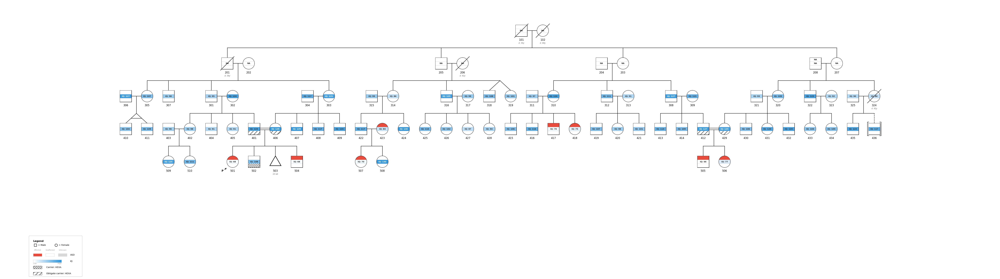
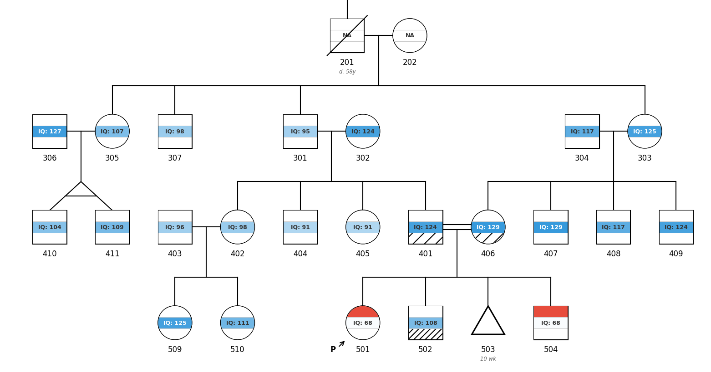

# Examples Gallery

Each example file in `tests/data/` demonstrates specific pypedigree features, organized by subdirectory. Render any example with:

```bash
pypedigree tests/data/<subdir>/<file>.ped -o output.png
```

---

## simple_trio.ped

**Description**: Father, mother, and one affected child.

**Features**: Basic trio layout, affected (filled) shape, label rendering.

```bash
pypedigree tests/data/basic/simple_trio.ped -o simple_trio.png
```

---

## two_gen_siblings.ped

**Description**: Two parents and three children.

**Features**: Sibship line connecting multiple siblings, horizontal ordering.

```bash
pypedigree tests/data/basic/two_gen_siblings.ped -o two_gen_siblings.png
```

---

## three_gen.ped

**Description**: Grandparents, parents, and two grandchildren.

**Features**: Multi-generation layout with three vertical levels, descent lines.

```bash
pypedigree tests/data/basic/three_gen.ped -o three_gen.png
```

---

## extended_markers.ped

**Description**: Three generations with a deceased grandfather and a proband child. Uses the extended 10-column format.

**Features**: Deceased marker (diagonal slash), proband marker ("P" annotation), extended column parsing (columns 7-10: DOB, twins, deceased, proband).

```bash
pypedigree tests/data/extended/extended_markers.ped -o extended_markers.png
```

---

## consanguinity.ped

**Description**: First-cousin marriage across three generations. Grandparents produce two children who marry unrelated spouses. Their children (first cousins) marry each other.

**Features**: Automatic consanguinity detection via shared ancestor analysis, double relationship line for consanguinous unions.

```bash
pypedigree tests/data/consanguinity/consanguinity.ped -o consanguinity.png
```

---

## twins.ped

**Description**: Parents with MZ (monozygotic) twins and additional siblings, with dates of birth for ordering.

**Features**: Twin connectors (V-lines from sibship to children), MZ horizontal bar, DOB-based sibling ordering (older siblings to the left).

```bash
pypedigree tests/data/twins/twins.ped -o twins.png
```

---

## multiple_relationships.ped

**Description**: One individual (father) with two different partners and children from each union.

**Features**: Duplicate node creation (same individual appears twice), dotted arc connecting duplicate instances, separate sub-tree layout for each union.

```bash
pypedigree tests/data/multi_partner/multiple_relationships.ped -o multiple_relationships.png
```

---

## Style customization

**Description**: Any pedigree can be rendered with custom visual styles using the `--style` JSON file or direct CLI options.

**Example — grey outlines**: Render shapes and deceased markers with grey outlines instead of black.

```bash
# Via CLI option
pypedigree tests/data/extended/extended_markers.ped --outline-color grey -o grey_outlines.png

# Via JSON style file
echo '{"outline_color": "grey"}' > style.json
pypedigree tests/data/extended/extended_markers.ped --style style.json -o grey_outlines.png
```

See the [PedigreeStyle reference](api.md#pedigreestyle) for all available parameters.

---

## Multi-phenotype rendering (banded nodes)

**Description**: Display multiple phenotypes as horizontal color bands inside each individual's shape. Binary phenotypes show color (affected), white (unaffected), grey (unknown/0), or "NA" (no data/-9). When all bands are NA, a single centered "NA" is shown. Continuous phenotypes show a color gradient proportional to the normalized value. The legend is sized from `font_size`: its text, swatches and rows keep the same physical size whatever the size of the pedigree, and the figure grows downward to make room for it.

**With inline phenotypes** (columns 11+ in the .ped file, requires header):

```bash
pypedigree mockup_v2.ped -o mockup_v2.png
```

**With a separate .pheno file** + custom colors:

```bash
pypedigree family.ped --pheno data.pheno --style style.json -o output.png
```

Where `style.json` maps phenotype names to colors:

```json
{"phenotype_colors": {"epilepsy": "#e74c3c", "IQ": "#3498db", "SRS": "#e67e22"}}
```

Colors are auto-assigned from a default palette if no `phenotype_colors` are provided.

---

## PGS distribution

**Description**: If a column named `PGS` (case-insensitive) is present in the data, a vertical gaussian distribution curve is drawn to the left of each individual with a red marker indicating their score.

```bash
# PGS as column 14 (inline)
pypedigree mockup_with_pgs.ped -o output.png

# PGS in a separate .pheno file
pypedigree family.ped --pheno data_with_pgs.pheno -o output.png
```

---

## Annotations

**Description**: Columns with the `a_` prefix in the .ped header are annotation columns. Their values are displayed as italic grey text below the individual's ID label. Missing values (0, -9, NA, empty) produce no annotation line. Annotations can also be loaded from a separate file via `--annotations`.

**With inline annotations** (header-based `a_` prefix columns):

```bash
pypedigree tests/data/phenotype/test_all.ped -o annotations.png
```

**With a separate annotation file**:

```bash
pypedigree family.ped --annotations annotations.tsv -o annotations.png
```

**Python API**:

```python
from pypedigree import PedigreeBuilder

builder = PedigreeBuilder("FAM1")
builder.add_individual("father", sex="male", annotations=["Clinic: Paris", "Ref: 42"])
builder.add_individual("mother", sex="female")
builder.add_individual("child", sex="male", father="father", mother="mother")
fig = builder.render(output="annotations.png")
```

---

## Diverging gradient

**Description**: Use `gradient_diverging` in the style JSON to define a tricolor gradient for continuous phenotypes. Values below the midpoint blend from `color_low` to white, values above blend from white to `color_high`.

```bash
echo '{"gradient_diverging": {"IQ": {"min": 40, "mid": 100, "max": 160, "color_low": "#e74c3c", "color_high": "#2ecc71"}}}' > style.json
pypedigree family.ped --style style.json -o diverging.png
```

---

## Multiple PGS columns

**Description**: Any column starting with `PGS` (case-insensitive) is treated as a PGS column. Multiple PGS values are displayed on a single gaussian curve with distinct colored markers.

```
FID	ID	Father	Mother	Sex	PGS_autism	PGS_IQ	PGS_ADHD
FAM1	1	0	0	1	0.72	-0.35	0.10
```

```bash
echo '{"pgs_colors": {"PGS_autism": "#e74c3c", "PGS_IQ": "#3498db", "PGS_ADHD": "#e67e22"}}' > style.json
pypedigree family.ped --style style.json -o multi_pgs.png
```

---

## Zero-padded IDs

**Description**: Use the `zero_pad_ids` style option to zero-pad sample IDs in labels. For example, with `zero_pad_ids: 3`, ID `1` displays as `001`.

```bash
echo '{"zero_pad_ids": 3}' > style.json
pypedigree family.ped --style style.json -o padded_ids.png
```

---

## Gradient inverted (gi_ prefix)

**Description**: The `gi_` prefix activates `GRADIENT_INVERTED` mode, producing a color-to-white scale where high values are white and low values are the full color. This is useful for metrics where low values indicate concern (e.g., IQ: low IQ = more red).

```
FID	ID	Father	Mother	Sex	gi_IQ
FAM1	1	0	0	1	70
FAM1	2	0	0	2	120
```

```bash
pypedigree family_with_gi.ped -o gradient_inverted.png
```

---

## Rendering all examples at once

```bash
for f in tests/data/**/*.ped; do
    pypedigree "$f" -o "/tmp/$(basename "${f%.ped}.png")"
done
```

## carrier.ped

**Description**: Three-generation family demonstrating carrier notation. Grandmother, father and child2 are carriers, aunt and cousin1 are obligate carriers.

**Features**: NSGC 2022 carrier notation: carriers have a patterned symbol, obligate carriers a sparser version of the same pattern, both defined in the legend. `--carrier-notation legacy` draws the pre-2022 half-filled shapes and center dots instead.

```bash
pypedigree tests/data/phenotype/carrier.ped -o carrier.png
pypedigree tests/data/phenotype/carrier.ped --carrier-notation legacy -o carrier_legacy.png
```

---

## carrier_genes.ped

**Description**: Carrier status for two genes, one `cr_` column each (`cr_CFTR`, `cr_HEXA`). The father carries both and his symbol is split in two patterns; child1 is affected and an obligate CFTR carrier, so his symbol is half filled, half patterned. A missing value (`-9`) is not drawn.

**Features**: `cr_` carrier columns, one pattern per gene, symbols divided as NSGC 2022 recommends.

```bash
pypedigree tests/data/phenotype/carrier_genes.ped -o carrier_genes.png
```

---

## nomenclature.ped

**Description**: Every standard notation symbol beyond sex, affection status and death (NSGC nomenclature, 2008 and its 2022 revision). FAM1: II-1 is infertile (two bars, reason in an `a_` column), II-2 the consultand (arrow without "P"), II-4 a transgender woman (circle, AMAB below), II-5 non-binary and childless by choice (diamond, one bar, AFAB below), II-6 a miscarriage (triangle). In the third generation: the proband, a child adopted in (brackets, dashed line), a child adopted out (brackets), a stillbirth ("SB"), an affected termination (filled, struck-through triangle), an ectopic pregnancy ("ECT") and an ongoing pregnancy ("P"). FAM2: a sperm donor ("D") and an affected pregnancy.

**Features**: `pregnancy`, `adopted`, `childless`, `art`, `gender_identity` and `consultand` columns; gestational ages in an `a_` column.

```bash
pypedigree tests/data/nomenclature/nomenclature.ped -o nomenclature.png
pypedigree tests/data/nomenclature/nomenclature.ped --interactive -o nomenclature.svg
```

---

## Interactive SVG

**Description**: Any pedigree can be exported as an interactive SVG with tooltips and click-to-highlight. It carries the same phenotype bands, legend, PGS curves and annotations as the PNG.

```bash
# Generate interactive SVG
pypedigree tests/data/basic/three_gen.ped --interactive -o interactive.svg

# Multi-phenotype pedigree with its style file
pypedigree tests/data/phenotype/test_all.ped --style tests/data/phenotype/test_all_style.json \
    --interactive -o test_all.svg

# Open in browser for tooltips and click highlighting
open interactive.svg
```

**Python API**:

```python
from pypedigree import parse_pedigree, render_interactive_svg

ped = parse_pedigree("tests/data/basic/three_gen.ped")
render_interactive_svg(ped, output="interactive.svg")
```

---

## Programmatic Builder API

Build pedigrees from code without writing .ped files:

```python
from pypedigree import PedigreeBuilder

builder = PedigreeBuilder("FAM1")
builder.add_individual("gf", sex="male")
builder.add_individual("gm", sex="female")
builder.add_individual("father", sex="male", father="gf", mother="gm")
builder.add_individual("mother", sex="female")
builder.add_individual("child", sex="male", father="father", mother="mother",
                       phenotype="affected", phenotypes={"IQ": 85, "epilepsy": 1})
fig = builder.render(output="builder_example.png")
```

---

## synesthesia.ped

**Description**: Synthetic pedigree, written by `tests/data/generate_fixtures.py` from a fixed seed — 45 individuals across 3 generations with 3 phenotype columns.

**Features**: Smart header-based column mapping, prefix-based display modes (`b_ASD`, `b_Synesthesia`, `o_Psychiatric comorbidities`), Deceased and Proband columns, 0 vs -9 distinction (unknown vs no data), legend sized from the font, large family layout.

```bash
# --style takes a path to a JSON file:
cat > style.json <<'EOF'
{"phenotype_colors": {"ASD": "#e74c3c", "Synesthesia": "#3498db", "Psychiatric comorbidities": "#e67e22"}}
EOF
pypedigree tests/data/complex/synesthesia.ped --style style.json -o synesthesia.png
```

---

## multigenerational.ped



Detail of the first branch: 401 and 406 are first cousins, grandchildren of 201. Their parents' sibships are ordered so they meet: 401 is the last of his sibship, 406 the first of hers.



**Description**: Synthetic pedigree, written by `tests/data/generate_fixtures.py` from a fixed seed. 81 individuals over five generations descending from one founder couple. Two loops: a first-cousin marriage (401 and 406, double line) and a marriage between the second and fourth branches (412 and 429, second cousins). Both are drawn with the partners side by side and no duplicated individual: each sibship on the way down from the common ancestors is ordered so the two branches meet. The affected children below both loops (501, the proband, 504, 505 and 506) have unaffected obligate-carrier parents; their brother 502 is a carrier.

**Features**: loops, `b_ASD` binary band, `g_IQ` gradient band with values, `cr_HEXA` carrier band (carrier and obligate carrier), dizygotic (318-319) and monozygotic (410-411) twins, deceased individuals with their age at death in an `a_` column, a miscarriage (503) and a child adopted in (436), `-9` no-data values for the oldest generations. Identifiers are cohort-style (generation, then rank in the file), not the clinical left-to-right numbering, since loop ordering moves siblings.

```bash
pypedigree tests/data/complex/multigenerational.ped -o multigenerational.png
# Interactive version, to zoom in and hover over individuals
pypedigree tests/data/complex/multigenerational.ped --interactive -o multigenerational.svg
```

---

## Circular / Radial Layout

**Description**: Any pedigree can be rendered in a circular/radial layout where founders sit at the center and each subsequent generation occupies a concentric ring outward, in the left-to-right order of the default layout. Twins, duplicates and loops are drawn as in the default layout. Edges are drawn as polylines following waypoints for smooth curved routing.

```bash
# Circular layout from CLI
pypedigree tests/data/basic/three_gen.ped --circular -o three_gen_circular.png

# Combine with other options
pypedigree tests/data/complex/synesthesia.ped --circular --dpi 300 -o synesthesia_circular.png
```

**Python API**:

```python
from pypedigree import parse_pedigree, render_pedigree, PedigreeStyle

ped = parse_pedigree("tests/data/basic/three_gen.ped")
fig = render_pedigree(ped, circular=True, output="three_gen_circular.png")

# Tune ring spacing
style = PedigreeStyle(radial_gap=3.0, base_radius=2.5)
fig = render_pedigree(ped, style=style, circular=True, output="custom_circular.png")
```

**Builder API**:

```python
from pypedigree import PedigreeBuilder

builder = PedigreeBuilder("FAM1")
builder.add_individual("gf", sex="male")
builder.add_individual("gm", sex="female")
builder.add_individual("father", sex="male", father="gf", mother="gm")
builder.add_individual("mother", sex="female")
builder.add_individual("child", sex="male", father="father", mother="mother", phenotype="affected")
fig = builder.render(circular=True, output="builder_circular.png")
```

---

## Python API

All examples can also be rendered programmatically:

```python
from pypedigree import parse_pedigree, render_pedigree, PedigreeStyle

ped = parse_pedigree("tests/data/consanguinity/consanguinity.ped")
fig = render_pedigree(ped, style=PedigreeStyle(dpi=300), output="consanguinity.png")
```
